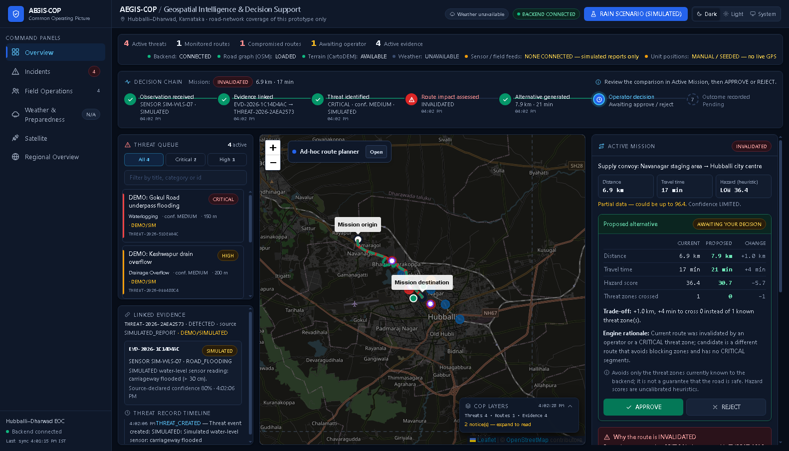
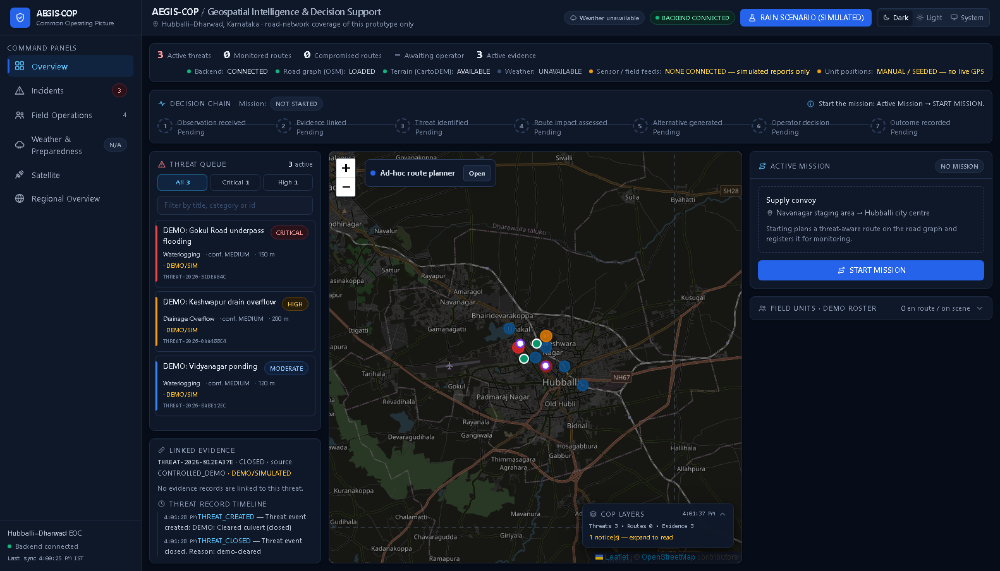
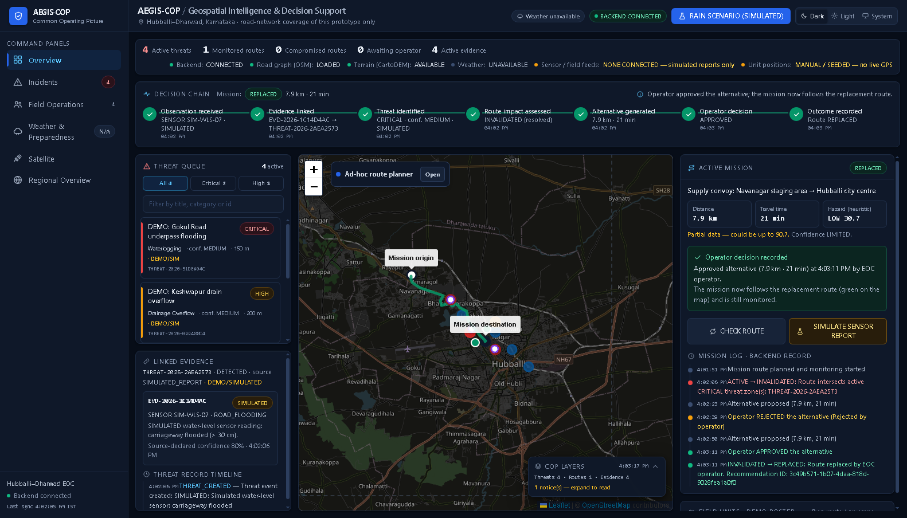
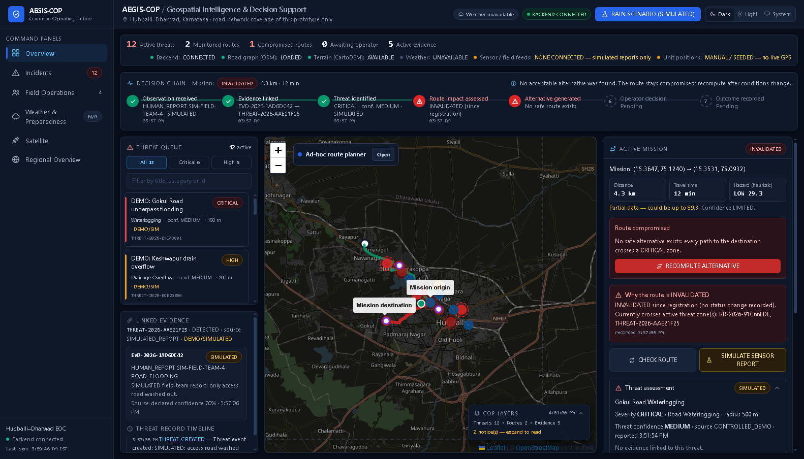
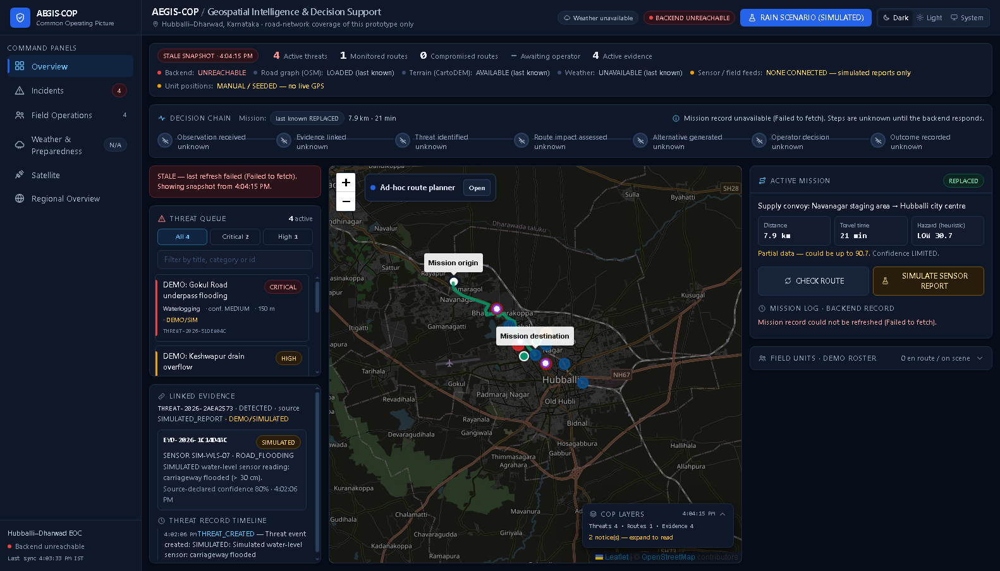
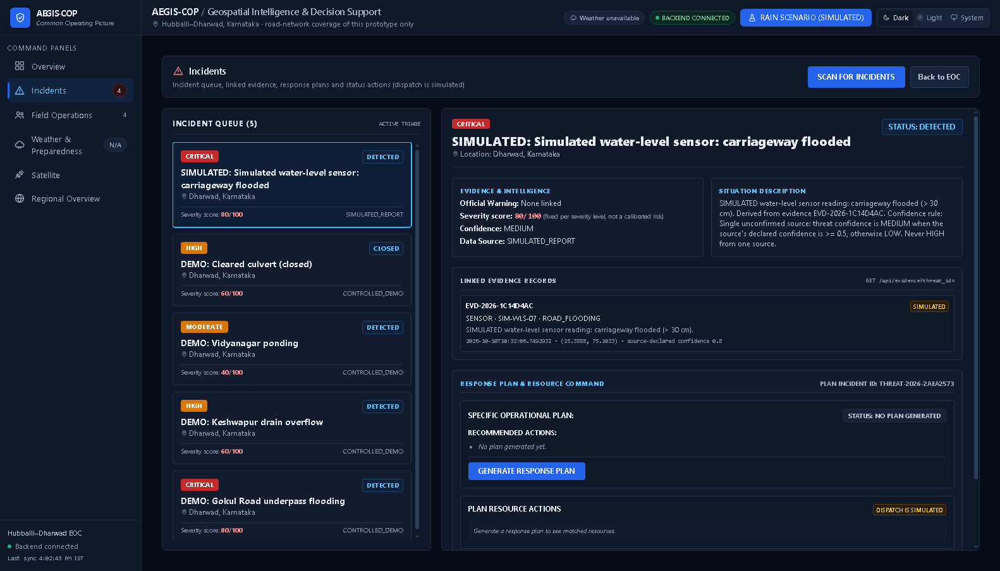
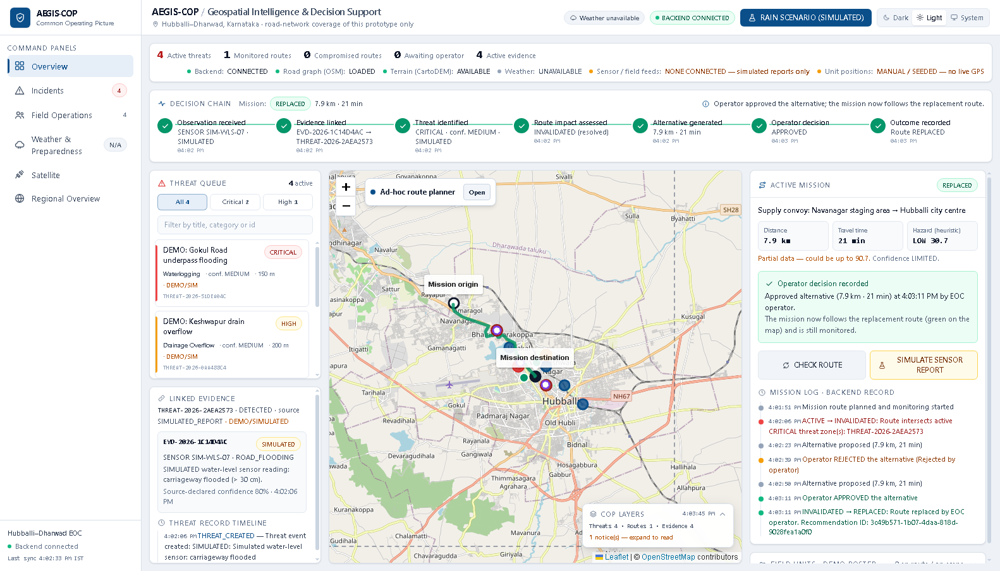

# AEGIS-COP

**A tactical-edge Common Operating Picture (COP) for flood-response route decisions in
Hubballi-Dharwad, India.**

AEGIS-COP is an edge-oriented geospatial decision-support COP: it links observations,
evidence, threats and geographic context to route impact, explains the resulting
recommendation, and leaves the decision to a human operator.

```
Observation → Evidence → Threat → Geographic context → Route impact → Explainable recommendation → Human review
```

> **This is a hackathon research prototype, not an operational system.** Hazard scores
> are uncalibrated heuristics, field and sensor reports in the demo are **simulated**,
> live sensor ingestion and multimodal fusion are not configured, and the optional video
> module provides generic object detection only (not validated threat detection). The
> routing graph covers Hubballi-Dharwad only. See
> [docs/LIMITATIONS.md](docs/LIMITATIONS.md).



## Problem

During urban flooding, an Emergency Operations Centre (EOC) has to keep convoys and
response teams moving on roads that change minute by minute. Reports arrive from field
teams and sensors, but there is rarely one place that shows the threat, the evidence
behind it, which planned routes it compromises, what the alternative costs, and who
approved the change.

AEGIS-COP builds on the earlier *ResilienceRoute* flood-routing project. It ties those
pieces into one auditable workflow on a shared map.

## What it does (the mission workflow)

1. **Mission setup.** The operator starts a supply-convoy mission (Navanagar staging area
   → Hubballi city centre). The backend plans a threat-aware route on the OpenStreetMap
   road graph and registers it for monitoring. The map shows the route, origin,
   destination and the mission area (road-network coverage).
2. **Simulated field/sensor report.** A reproducible report, labelled **SIMULATED**,
   creates a canonical evidence record with provenance (`is_simulation: true`) and a
   threat linked to it.
3. **Threat assessment.** The panel shows severity, category, source, timestamp, linked
   evidence and confidence. Threat confidence comes from a documented rule: a single
   unconfirmed source is MEDIUM if its declared confidence is ≥ 0.5, otherwise LOW, and
   never HIGH. The evidence confidence is labelled as fixed by the simulation profile,
   not measured.
4. **Route compromise.** The route monitor applies the routing policy. An active
   CRITICAL zone is a hard exclusion (zone radius + 25 m buffer), so the mission route
   becomes **INVALIDATED** with the threat id in the reason.
5. **Alternative.** The threat-aware engine computes a replacement that does not enter
   blocking zones. The panel compares current and proposed routes using backend metrics:
   distance, travel time, heuristic hazard score and threat zones crossed. If no
   acceptable route exists, the UI says so (`NO_SAFE_AVAILABLE_ROUTE`) and does not
   invent one.
6. **Operator decision.** The operator can **APPROVE** or **REJECT**. Both are persisted,
   with a reason. A rejected proposal leaves the route compromised; the operator can
   recompute.
7. **Consistent outcome and timeline.** The map, mission panel, incident desk, COP
   counts and backend agree. The mission log is built from persisted route transitions
   and recommendation decisions, and it survives a page reload and a backend restart.

The Overview shows this chain at a glance:
- **Operational summary:** counts from the COP summary (active threats, monitored and
  compromised routes, active evidence) plus decisions awaiting the operator, next to
  data-source availability — what is live, simulated, unavailable or only last known
  (backend, road graph, terrain, weather, sensor feeds, unit positions).
- **Decision chain:** a seven-stage stepper — Observation received → Evidence linked →
  Threat identified → Route impact assessed → Alternative generated → Operator decision
  → Outcome recorded — each with its recorded time and state (complete, awaiting
  action, adverse result, needs attention, pending, unknown). It also says what the
  operator should do next.
- **Active Mission panel:** why the route was invalidated, the current-versus-proposed
  comparison with the trade-off, the engine's rationale, and APPROVE/REJECT.
- **Threat queue and evidence card:** the active threats; selecting one shows its linked
  evidence and the threat record's timeline.
- **Themes:** dark (default), light or system, chosen in the header. The layout adapts
  from wide desktop down to tablet width (the sidebar collapses to an icon rail below
  1280 px, and the map moves to the top).

The rest of the dashboard comes from the ResilienceRoute base and is reached from the
left navigation. Simulated parts are labelled as such:
- **Incident desk:** linked evidence, response plans, and recording a *simulated*
  dispatch.
- **Field-unit status:** transitions validated by the backend.
- **Weather/preparedness:** live Open-Meteo when reachable, or the labelled
  **RAIN SCENARIO (SIMULATED)**.
- **Ad-hoc threat-aware route planner.**
- **Video Intelligence (new prototype):** upload a video, run generic YOLO object detection on sampled frames, attempt ByteTrack IDs, review the annotated sample reel and record the observation in the canonical evidence store. It does not infer hostile intent, automatically create a threat, or automatically change a route.

## Screenshots

These are real captures from headless Chrome against the local backend on a fresh demo
database, with outbound network calls blocked. That is why weather shows as
*unavailable*.

| | |
|---|---|
|  Overview: data sources, empty decision chain, demo threats |  Alternative approved: every chain step complete, route REPLACED |
|  Dead-end mission: "No safe alternative exists", no route invented |  Backend down: UNREACHABLE, STALE snapshot, chain steps "unknown" |
|  Incident desk with linked SIMULATED evidence |  Same mission state in the light theme |

## Architecture

```
React 19 + Leaflet (frontend/)                 FastAPI + SQLite (backend/)
┌──────────────────────────────┐   REST    ┌────────────────────────────────────────┐
│ EocDashboard                 │  /api/*   │ routes/        HTTP handlers            │
│  ├─ Map + COPLayers          │◄─────────►│ services/      domain logic             │
│  ├─ MissionPanel (workflow)  │           │   threat/  simulated_report, zones      │
│  ├─ IncidentCenter           │           │   evidence/  cop/  geo/                 │
│  └─ Field ops, weather, ...  │           │   routing_service (OSMnx/NetworkX)      │
└──────────────────────────────┘           │   route_monitor / route_replacement     │
                                           │   terrain_service (CartoDEM, optional)  │
                                           │ repositories/  SQLite persistence       │
                                           │ config/routing_policy.py  penalties     │
                                           └────────────────────────────────────────┘
```

Details, the mission sequence and the API surface:
[docs/ARCHITECTURE.md](docs/ARCHITECTURE.md). Design decisions (ADRs):
[docs/project/DECISIONS_AND_ROADMAP.md](docs/project/DECISIONS_AND_ROADMAP.md).

## Technology

- **Backend:** Python 3.10-compatible baseline, FastAPI, SQLAlchemy 2 + SQLite, OSMnx 2.0.5 / NetworkX,
  Shapely, rasterio, pytest.
- **Frontend:** React 19, Vite 8, Leaflet / react-leaflet, Tailwind CSS, oxlint.
- **Data:** OpenStreetMap drive graph (tracked, ODbL); optional local CartoDEM V3 tile
  (not distributed); Open-Meteo weather (optional, online).

## Installation

Recommended local setup: **Python 3.10 (Windows x64 supported)** and **Node.js 20.19+**.
The backend dependency pins were changed from the original Linux/Python 3.12 lock snapshot
to a Python 3.10-compatible baseline. The package set still needs to be verified on each
target machine; use the commands below and report any resolver error rather than mixing
versions from old environments.

### Windows (VS Code / PowerShell or Command Prompt)

Run these from the repository root (`aegis-cop-main`):

```powershell
py -3.10 -m venv .venv
.\.venv\Scripts\python.exe -m pip install --upgrade pip
.\.venv\Scripts\python.exe -m pip install -r backend\requirements-dev.txt -c backend\requirements.lock.txt
```

For the optional video-intelligence feature, install its dependencies in the same
environment:

```powershell
.\.venv\Scripts\python.exe -m pip install -r backend\requirements-vision.txt
```

Install Node.js 20.19+ LTS from https://nodejs.org/ if `node --version` or `npm --version`
is not recognized. Restart VS Code after installation. Then:

```powershell
cd frontend
npm ci
```

### Ubuntu / Linux

```bash
python3.10 -m venv .venv
.venv/bin/python -m pip install --upgrade pip
.venv/bin/python -m pip install -r backend/requirements-dev.txt -c backend/requirements.lock.txt
.venv/bin/python -m pip install -r backend/requirements-vision.txt
cd frontend && npm ci
```

Terrain is optional. To enable it, download CartoDEM tile D43D yourself (see
[data/terrain/README.md](data/terrain/README.md)) and point `DEM_PATH` at it. Without it,
terrain is reported as *unknown* and hazard scores are marked partial.

## Video Intelligence (optional add-on)

The existing React/Vite frontend includes a **Video Intelligence** navigation panel.
The backend endpoint is `/api/vision/analyze-video`; its status is `/api/vision/status`.
Vision dependencies are separate because PyTorch/Ultralytics are large and may need
GPU-specific installation.

From the repository root, install them in the same environment:

```powershell
.\\.venv\\Scripts\\python.exe -m pip install -r backend\\requirements-vision.txt
```

On Linux/macOS:

```bash
.venv/bin/python -m pip install -r backend/requirements-vision.txt
```

The first inference may download `yolov8n.pt`; set `AEGIS_YOLO_MODEL` to a local compatible
Ultralytics model path if needed. A CPU run works but may be slow.

Video analysis saves an annotated sampled-frame reel under `data/vision_runs/` and creates
an unverified canonical evidence record. The uploaded original is deleted after processing.
The feature is a generic object detector/tracker, not a trained naval/army threat classifier;
it cannot infer hostile intent. AIS/satellite fusion, GPS extraction from video, automatic
threat creation, and route-engine integration are not implemented. See
[docs/LIMITATIONS.md](docs/LIMITATIONS.md).

## Configuration

Copy `backend/.env.example` to `backend/.env` if you need to change defaults. The main
variables:

| Variable | Default | Purpose |
|---|---|---|
| `DATABASE_PATH` | `data/aegis.db` | SQLite file. Use a fresh path for a clean demo |
| `OSM_GRAPH_PATH` | `data/osm/hubballi_dharwad_drive.graphml` | Road graph |
| `DEM_PATH` | `data/terrain/cdnd43d_v3r1/cdnd43d.tif` | Optional CartoDEM tile |
| `MAX_SNAP_DISTANCE_M` | `250` | Inputs farther than this from the road network are rejected (`OUTSIDE_COVERAGE`) |
| `WEATHER_MAX_AGE_MINUTES` | `90` | Older weather observations are treated as stale |
| `VITE_API_BASE_URL` (frontend) | `http://127.0.0.1:8000/api` | Backend URL |

No API keys are required. The IMD, MOSDAC and FIRMS integrations are disabled or
stubbed unless you configure your own access.

## Running the demo

The short version:

```bash
# terminal 1: backend, offline, fresh database
cd backend
DATABASE_PATH=$(mktemp -d)/demo.db HTTPS_PROXY=http://127.0.0.1:9 HTTP_PROXY=http://127.0.0.1:9 \
  NO_PROXY=localhost,127.0.0.1 ../.venv/bin/python -m uvicorn app.main:app --host 127.0.0.1 --port 8000

# terminal 2: frontend
cd frontend && npm run dev                      # http://localhost:5173

# terminal 3: labelled demo fixtures (refuses to run on a non-empty database)
.venv/bin/python scripts/demo/seed_demo.py
```

Then, in the **Active Mission** panel: **START MISSION** → **SIMULATE SENSOR REPORT** →
**REJECT** or **APPROVE**. For the honest-failure case, run
`.venv/bin/python scripts/demo/no_safe_route_case.py`, then **CHECK ROUTE** →
**COMPUTE ALTERNATIVE ROUTE**. The click-by-click script, expected results, reset and
recovery steps are in [docs/DEMO.md](docs/DEMO.md).

## Tests

```bash
cd backend && ../.venv/bin/python -m pytest      # offline, temp SQLite, sockets blocked
cd frontend && npm run lint && npm run build
```

- Last recorded run (2026-10-10) with the DEM present: 137 passed.
- Without the DEM: 110 passed, 27 skipped with reasons. Without the DEM and the road
  graph: 68 passed, 69 skipped.
- `tests/test_mission_workflow.py` covers:
  - report → evidence + threat → INVALIDATED;
  - reject, then approve;
  - unknown inputs;
  - an honest no-safe-route case.
- Do not run the scripts in `backend/legacy_checks/` or `scripts/legacy_checks/`. They
  call a live server and can change its database.

## Data attribution and licensing

- **Road network:** © OpenStreetMap contributors, ODbL 1.0
  ([data/osm/README.md](data/osm/README.md)). Map tiles: © OpenStreetMap contributors.
- **Terrain:** CartoDEM, National Remote Sensing Centre, ISRO, Government of India.
  It is **not included**: its licence is single-user and excludes Internet hosting.
- **Weather:** Open-Meteo (when online). Satellite overlay: NASA GIBS.
- Full register: [docs/DATA_SOURCES.md](docs/DATA_SOURCES.md).
- **Code licence:** none has been chosen yet. Until a `LICENSE` file is added, the
  default copyright rules apply. A code licence would not cover third-party data, and
  it would never allow redistribution of CartoDEM.

## Limitations (summary)

- **Heuristic scores.** Hazard scores and routing penalties are uncalibrated
  (`backend/app/config/routing_policy.py`).
- **Simulated inputs.** Field and sensor reports are simulated. The "AI" evidence
  analysis is a filename-keyword mock. Drainage data is synthetic.
- **Single-point weather.** Weather is sampled at one point for the whole city.
- **Partial terrain coverage.** About 12.6% of the road graph lies outside the DEM tile.
- **No security layer.** There is no authentication: decisions record a self-declared
  operator name and reason. Bind the API to `127.0.0.1`.
- **No detection.** Threats are recorded, not detected: simulated reports, API clients,
  demo fixtures (the incident scan uses a built-in demo region list when no regional
  feed is configured).
- **Unproven portability.** Behaviour is only tested on Hubballi-Dharwad, so regional
  portability is not demonstrated.

Full list: [docs/LIMITATIONS.md](docs/LIMITATIONS.md). Verified versus unverified status:
[docs/project/IMPLEMENTATION_STATUS.md](docs/project/IMPLEMENTATION_STATUS.md).

## Roadmap

These are planned, not implemented:
1. Real evidence ingestion (field app / sensor feeds) with provenance.
2. Multi-source confidence (corroboration) replacing the single-source rule.
3. Calibrated hazard scoring against observed flooding.
4. Authentication and roles for approve/reject.
5. Region-independent data pipeline.

See [docs/project/DECISIONS_AND_ROADMAP.md](docs/project/DECISIONS_AND_ROADMAP.md).
